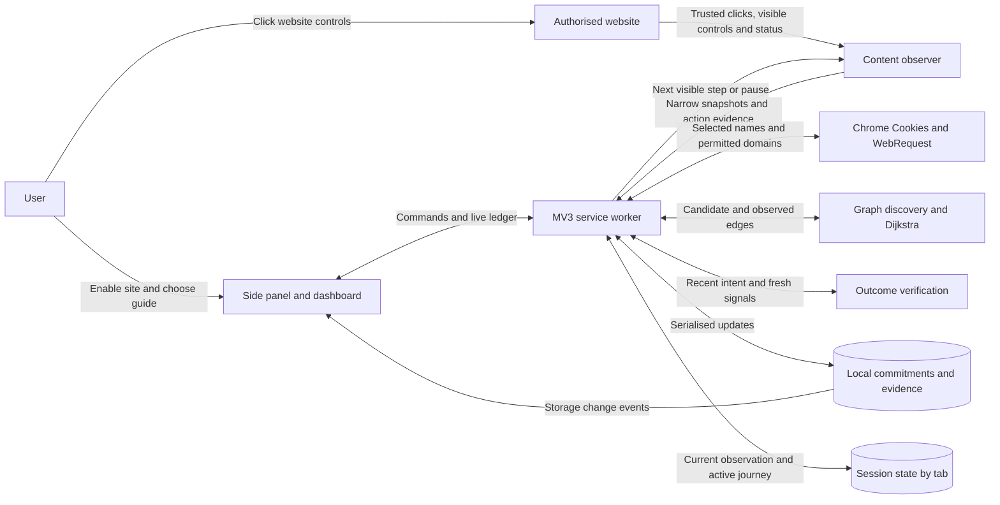

# Architecture

ExitLens runs in a Manifest V3 extension. Stillframe is a separate site that exercises normal HTML interactions. The same observation and graph code runs on any HTTP or HTTPS origin the user authorises.

## From observation to commitment

1. The dashboard requests Chrome access for the selected host. The worker records the exact origin and registers the content observer. The observer waits for the worker to confirm the top-frame origin before reading page evidence.
2. The observer matches accessible button names and nearby context. It sends a limited classification and recognised terms, using visible controls and status text from the DOM. A mutation observer captures changes after navigation or interaction.
3. The worker serialises record updates. Chrome local storage holds observations across browser sessions. Session storage holds the active tab, audit window, in-progress guide and prior snapshot across worker restarts within a browser session.
4. A trial activation click creates a suspected commitment. A fresh positive account or welcome signal can promote it to active. Consent controls capture the observed choice.

## From commitment to reversal

The worker merges two forms of graph evidence. **Discovered** edges come from visible same-origin links and buttons. A button with an unknown destination points to a control node. **Observed** edges require a trusted control click followed by its observed destination. The React Flow graph exposes path evidence and confidence, and the guide highlights a visible matching control.

The planner scores an edge at one for the action, adds two when confirmation is required, then adds one per observed barrier. Dijkstra's algorithm compares known routes toward the highest-priority reachable target. The target tier prefers explicit reversal controls over account or settings links. Friction weights are illustrative estimates.

A human-verification cue pauses highlighting until the checkpoint changes. The observer reports visible site-provided audio or accessible alternatives where it recognises them. The user performs every website interaction.

## From reversal to evidence

A recent reversal action and fresh matching status in the same tab support **Verified by observable evidence**. An auto-renewal-off signal without explicit cancellation supports **Partially verified**. A journey begins **Pending verification**, can be ended as **Unable to verify**, and may be closed as **User marked as resolved**. Consent audits provide companion cookie and request observations.

The report stores the entry actions, guided reversal actions, source phrases, barriers and result. The ratio is available for a sufficiently observed entry and continuous, verified reversal. A missing portion of either journey leaves the ratio unavailable.

## Demo fixture

Stillframe has local fictional account state and publishes visible trial terms and cancellation status. Its simulated advertising request goes from `127.0.0.1:4173` to `localhost:4173/signals/ad.gif`. The local server returns a tiny image. The explicit fixture match labels the request as simulated in the report.

## Implementation map

| Module | Responsibility |
| --- | --- |
| [`extension/src/content`](../extension/src/content) | Trusted interactions, visible evidence, MutationObserver and in-page guidance |
| [`extension/src/background`](../extension/src/background) | Browser permissions, tab correlation, state transitions and worker messaging |
| [`extension/src/detectors`](../extension/src/detectors) | Labels, terms, URL redaction, status text and tracker classification |
| [`extension/src/graph`](../extension/src/graph) | Edge discovery, merging and shortest path search |
| [`extension/src/storage`](../extension/src/storage) | Record initialisation, manual resolution and ordered updates |
| [`extension/src/verification`](../extension/src/verification) | Evidence decision and ratio eligibility |
| [`extension/src/accessibility`](../extension/src/accessibility) | Selected axe-core rules and human checkpoint detection |
| [`extension/src/dashboard`](../extension/src/dashboard) | Shared dashboard and side panel |

## Presentation replay

The presentation at `/` uses in-memory fictional scenes with the same terms parser, reversal graph helpers and verification rules. It is separate from the live sandbox at `/stillframe`. The content observer skips the presentation route on the demo hosts.
